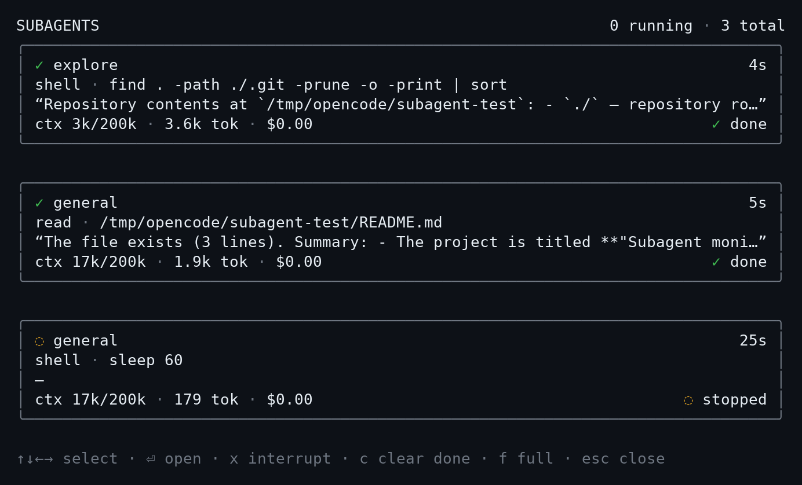
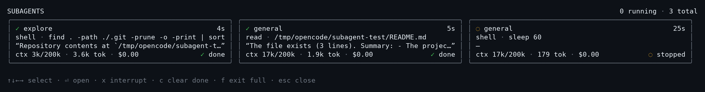

# opencode-subagent-monitor

A live subagent monitor panel for the [OpenCode](https://opencode.ai) V2 TUI.

It shows every subagent under the current session as a card in a responsive
side panel (or a fullscreen grid). Each card displays:

- agent name and elapsed time
- current tool / latest assistant text
- current context estimate (`ctx 84k / 128k`) when available
- cumulative token usage and cost
- run state (running / done / failed / interrupted)

## Screenshots

Side panel:



Fullscreen grid (`f`):



## Install

OpenCode V2 can install the plugin straight from this repository:

```sh
opencode plugin add github:jains99/opencode-subagent-monitor
```

Or pin a tag/commit:

```sh
opencode plugin add github:jains99/opencode-subagent-monitor@v0.1.0
opencode plugin add git+ssh://git@github.com/jains99/opencode-subagent-monitor.git#v0.1.0
```

After installing, start (or restart) the TUI.

## Usage

- `/subagents` or `ctrl+alt+s` — toggle the panel.
- `↑`/`↓`/`←`/`→` (or `h`/`j`/`k`/`l`) — select a card.
- `⏎` — open the selected subagent in the current tab.
- `x` — interrupt a running subagent (with confirmation).
- `c` — clear all visible finished cards permanently.
- `f` — toggle fullscreen.
- `esc` — close the panel.

### Finished cards

Succeeded subagents are **auto-hidden 30 seconds after they finish**, so the
panel stays focused on live work. Failed and interrupted cards are *not*
auto-hidden — they stay until you clear them.

`c` hides all visible finished cards permanently. The cleared session IDs are
stored with OpenCode's durable plugin storage, so they stay hidden across panel
reopens and TUI restarts. This is view-only: it does not delete child sessions
or their messages.

## Development

```sh
npm install
npm run typecheck
```

For local development, point OpenCode at the repository:

```jsonc
{
  "$schema": "https://opencode.ai/config.json",
  "plugins": ["file:///absolute/path/to/opencode-subagent-monitor/tui.tsx"]
}
```

## License

[MIT](./LICENSE)
